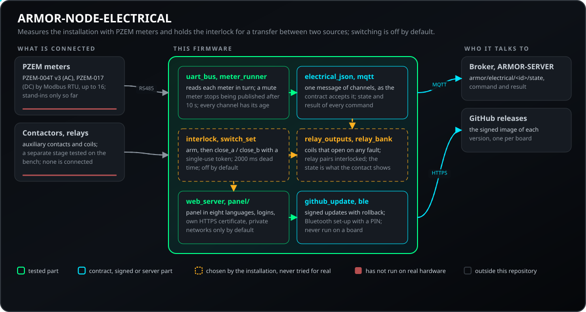
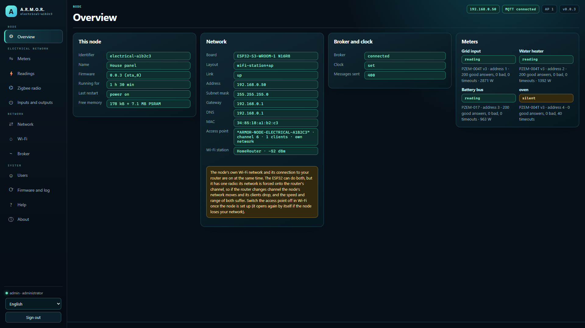
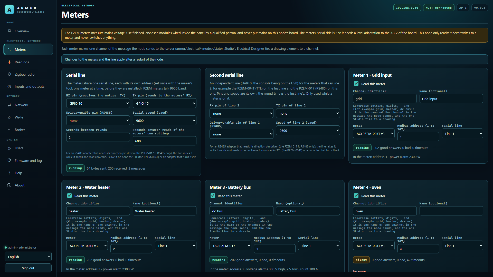
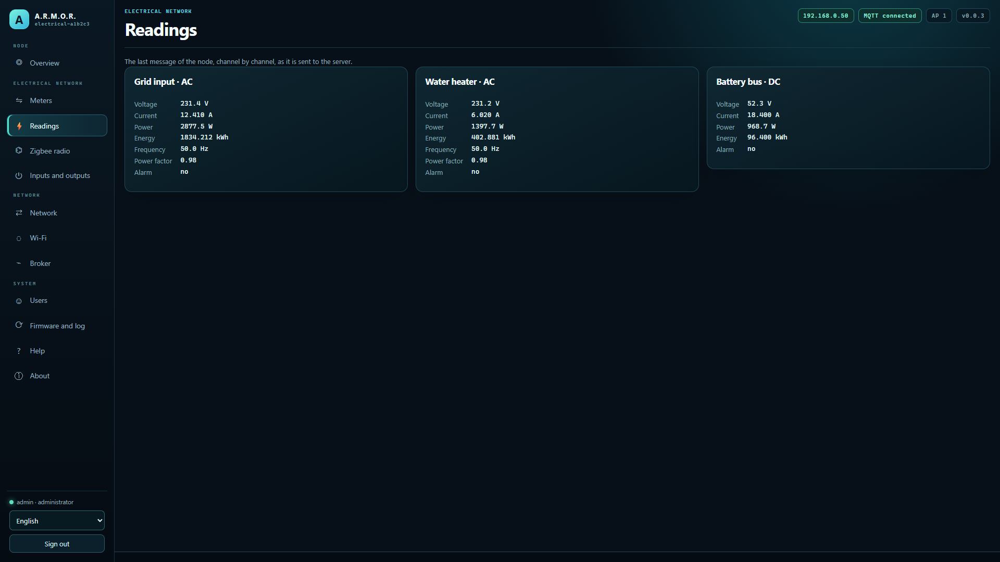
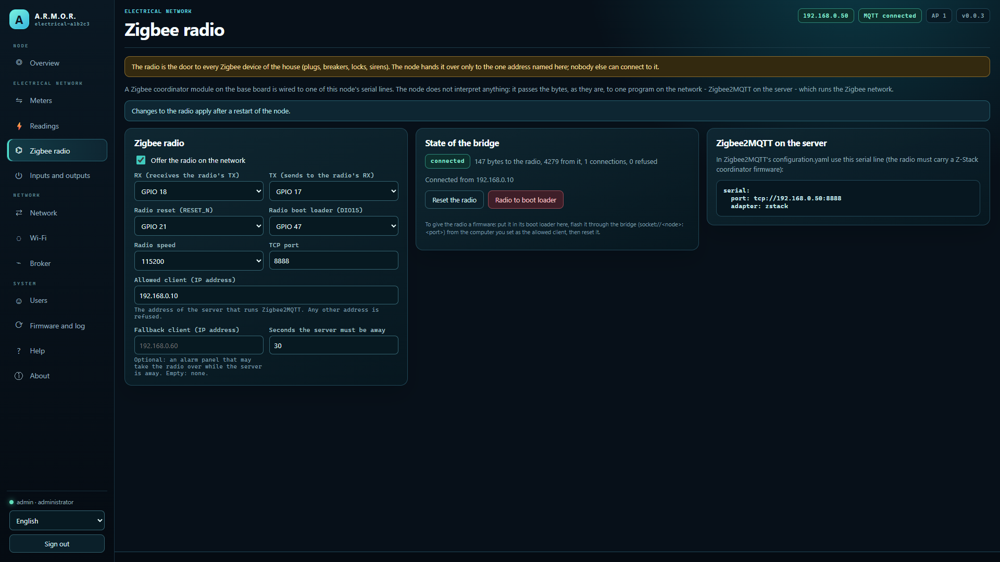
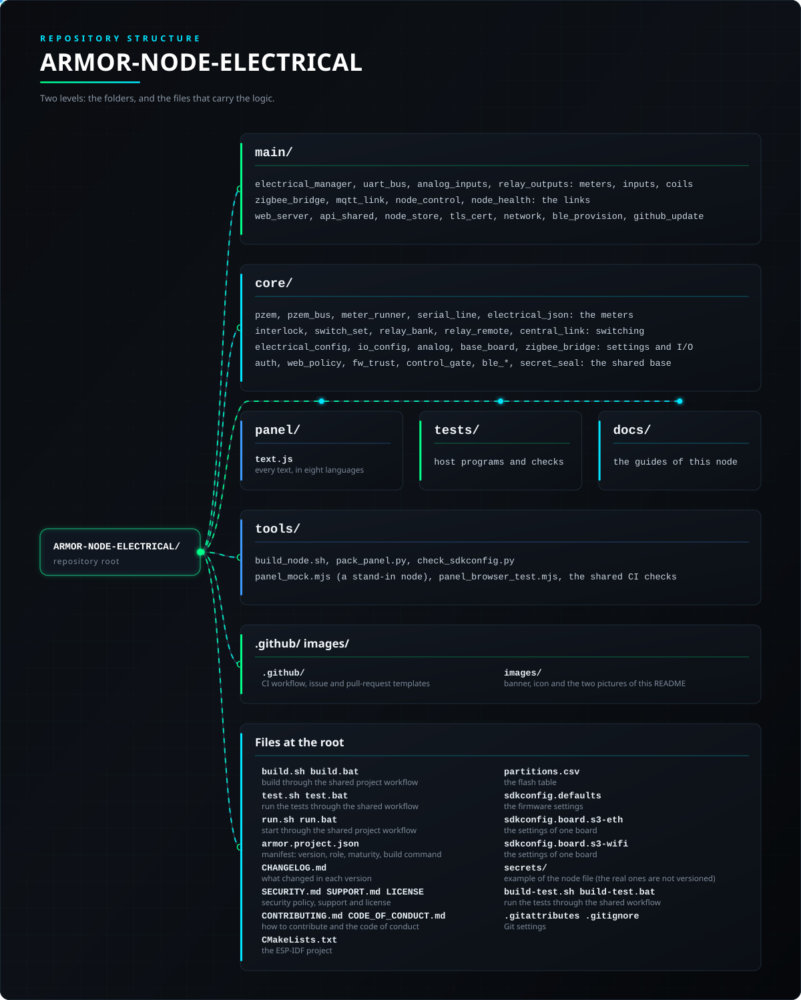

<p align="center">
  
</p>

# ⚡ ARMOR-NODE-ELECTRICAL

<p align="center">
  <a href="README.md">🇺🇸 English</a> |
  <a href="README_spa.md">🇪🇸 Español</a> |
  <a href="README_fra.md">🇫🇷 Français</a> |
  🇮🇹 <b>Italiano</b> |
  <a href="README_deu.md">🇩🇪 Deutsch</a> |
  <a href="README_zho.md">🇨🇳 简体中文</a> |
  <a href="README_jpn.md">🇯🇵 日本語</a> |
  <a href="README_por.md">🇵🇹 Português</a>
</p>

### Nodo elettrico: legge tensioni, correnti, potenza ed energia della rete AC e DC della casa e custodisce le regole per manovrarla (nucleo testato sul PC e un firmware che compila; non ha mai girato su una scheda)

<p align="center">
  
  
  
  
  
  
  
</p>

---

**Controllo di onestà - cosa funziona oggi:** Il nucleo (i frame dei contatori PZEM-004T v3 e PZEM-017, il bus che li interroga, il messaggio del nodo, gli ingressi analogici e le regole di commutazione: 382.264 controlli in 19 programmi di test, 375.036 dei quali sulle regole di commutazione) è provato su un computer con contatori e contattori sostitutivi, e i messaggi che produce sono accettati da ARMOR-COMMON. Il firmware del nodo (le impostazioni, la linea seriale, le pagine Contatori e Letture del suo pannello, Bluetooth, aggiornamenti firmati) si compila nel contenitore ESP-IDF 5.5.5 per entrambe le schede. **Non ha mai girato su una scheda, nulla è stato collegato a un contatore o a un contattore, e nulla qui commuta niente.**

---

## 📋 In breve

| | |
|---|---|
| Versione | `0.5.2` |
| Maturità | Funzionale |
| Ruolo | Nodo di campo elettrico: contatori, ingressi e manovra (famiglia: Field Nodes, padre: ARMOR-COMMON) |
| Tecnologia | C++17, ESP-IDF 5.5.5, ESP32-S3 |
| Test | 382264 verifiche in 19 programmi host e 5 verifiche Python (`ctest`) |
| Apparecchiature | Contatori PZEM-004T v3 e PZEM-017 (fino a 16), ingressi analogici, relè; manovra spenta di default |
| Gira su | Una scheda ESP32-S3 (Ethernet o Wi-Fi); test su host su qualsiasi computer |
| Su hardware reale | Ancora nessuno: nessuna scheda montata né contatore o contattore collegati; nulla commuta niente |
| Licenza | GPL-3.0-or-later |

**Vai a:** [Panoramica](#-panoramica) · [Architettura](#-architettura) · [Sicurezza](#-sicurezza-e-protezione) · [Interfacce](#-interfacce) · [Configurazione](#-configurazione) · [Avvio rapido](#-avvio-rapido) · [Test](#-test) · [Problemi](#-risoluzione-dei-problemi) · [Struttura](#-struttura-del-repository) · [Correlati](#-progetti-correlati)

## 🚦 Stato del progetto

Ogni riga è una parte di questo repository e il semaforo dice a che punto è oggi. È scritta in base a ciò che il repository può mostrare (test, compilazioni, esecuzioni), non a ciò che è previsto.

🟢 Fatto e verificato · 🟡 Funziona, con limiti noti · 🟠 Fatto a metà o non ancora verificato · 🔴 Non fatto o non funzionante

| Area | Stato | Cosa significa qui |
|---|---|---|
| Software | 🟢 | Il firmware compila nel contenitore ESP-IDF 5.5.5 per entrambe le schede (Wi-Fi ed Ethernet). |
| Test | 🟢 | Superano 382.264 controlli in 19 programmi host (`ctest`), 375.036 dei quali sulle regole di manovra; i contatori e i contattori sono simulazioni. |
| Protocolli e dati | 🟡 | I frame e le letture dei PZEM-004T v3 e PZEM-017 sono verificati contro i frame documentati e campioni registrati; nessun contatore ha ancora risposto. |
| Interfaccia | 🟡 | Le pagine dei contatori e delle letture del pannello web sono state provate in un browser contro un nodo simulato, non su una scheda. |
| Hardware | 🔴 | Nessuna scheda costruita e nessun contatore o contattore collegati: nulla ha ancora funzionato su apparecchiature reali. |
| Sicurezza | 🟡 | Il codice di configurazione, l'accesso con limite di password errate, il PIN Bluetooth e gli aggiornamenti firmati sono testati sull'host; non c'è stata una revisione indipendente. |
| Aggiornamenti | 🟠 | I controlli di hash e firma Ed25519 e la logica di ripristino passano sull'host; un aggiornamento via etere non è mai stato eseguito su una scheda. |
| Scrittura sulle apparecchiature | 🟠 | Le regole di manovra dei contattori sono provate solo contro contattori simulati; nulla qui ha ancora comandato qualcosa di reale. |
| Integrazione | 🟠 | I messaggi del nodo sono validati contro gli schemi condivisi e i vettori di conformità di ARMOR-COMMON. Il suo client MQTT viene provato contro un vero Mosquitto nei test; nessuna scheda li ha ancora inviati a un server. |
| Documentazione | 🟢 | Otto lingue, la guida del firmware, le note di cablaggio e il registro delle modifiche sono aggiornati. |

## 🎯 Panoramica

* **Lettura dei contatori:** i frame Modbus RTU dei **PZEM-004T v3** (AC) e **PZEM-017** (DC) di Peacefair: il CRC, la richiesta che legge i registri e la decodifica della risposta (tensione, corrente, potenza, energia, frequenza, fattore di potenza, allarme). Si costruisce solo la richiesta di lettura: quelle che scrivono in un contatore (indirizzo, soglie, azzeramento dell'energia) non si costruiscono da nessuna parte. Una risposta che non torna, o con un valore che nessun contatore reale potrebbe dare, viene rifiutata.
* **Il bus:** una linea con più contatori si interroga uno alla volta, con un timeout; si conserva l'ultima lettura buona di ciascuno e un contatore che tace non viene più pubblicato dopo dieci secondi.
* **Il messaggio** `armor/electrical/<nodo>/state`: una voce per canale (un circuito, una linea, l'ingresso di rete, un bus DC) con AC o DC, tensione, corrente, potenza, energia, frequenza, fattore di potenza, lo stato di un interruttore come lo vede il nodo e un allarme; è nel contratto condiviso e porta uno stato, mai un comando.
* **Le regole di manovra,** a prescindere da qualsiasi hardware: un controllore dello scambio tra due sorgenti che non comanda mai entrambe, richiede la manovra consentita, il nodo armato poco prima e i due contattori confermati aperti per tutto il tempo morto, e trasforma un contattore che non mostra ciò che gli è stato ordinato in un guasto che resta finché non viene riconosciuto. **La manovra è disattivata per impostazione predefinita e nulla pilota alcun hardware.**
* **I comandi a un commutatore, non attivati:** il messaggio di stato può portare lo stato dei commutatori del nodo, e il contratto condiviso ha un comando (`arm`, poi `close_a` o `close_b` con un token monouso, `open`, `acknowledge`) e la risposta del nodo; il nucleo li legge e risponde con le regole sopra, provato con i vettori condivisi e con contattori simulati. Nessuna immagine del firmware lo include, quindi nulla può azionare un contattore, e ARMOR-SERVER rifiuta di inviare un comando se non è stato attivato (`ARMOR_ELECTRICAL_SWITCHING=1`) e l'ACL del broker non lo consente.
* **Dove si vede:** il *Progettista elettrico* di ARMOR-STUDIO disegna la rete della casa e mostra su ogni elemento ciò che misura il suo canale; ARMOR-SERVER conserva le letture, la loro cronologia e le somme.
* **Il firmware del nodo** (ESP32-S3-WROOM-1 N16R8 in Wi-Fi, o la Waveshare ESP32-S3-ETH sul suo cavo): le impostazioni, una linea seriale per fino a sedici contatori e il pannello web degli altri nodi (messa in servizio, utenti, Wi-Fi, broker, aggiornamento via etere, HTTPS) con le sue pagine Contatori e Letture, in otto lingue. Legge soltanto: le regole di manovra non sono collegate. Vedi [il firmware](docs/NODE_FIRMWARE.md).
* **Configurazione dal telefono via Bluetooth,** lo stesso canale del nodo radar: l'app ARMOR trova il nodo come `ARMOR-XXXXXX` e ne imposta nome, Wi-Fi, indirizzo, broker e modo Bluetooth con gli utenti e il codice di messa in servizio del pannello ([il protocollo](docs/BLE_PROVISIONING.md)). Ascolta solo finché il nodo non ha utenti, salvo diversa impostazione. La parte radio non ha mai girato su una scheda.
* **Aggiornamenti via etere firmati:** il nodo installa da GitHub solo un'immagine il cui SHA-256 coincide e che porta una firma Ed25519 valida del responsabile (la chiave pubblica è nel firmware, quella privata non lascia mai il responsabile); un file caricato a mano da un amministratore nel pannello resta accettato. Le pagine e i messaggi del pannello sono in otto lingue.
* **Abbinamento Bluetooth con PIN:** il PIN a sei cifre deriva dal codice di configurazione, è stampato sulla console USB e mostrato a un amministratore nel pannello; il telefono deve inserirlo prima di poter scrivere le impostazioni del nodo.
* **Non ancora:** il firmware in funzione su una scheda, l'hardware, qualsiasi misura di un impianto reale e qualsiasi manovra.
* **Solo la casa può usare il pannello:** il pannello risponde per impostazione predefinita alla rete privata (o alle reti indicate dal proprietario, come una VPN), rifiuta un elenco che escluderebbe chi lo salva, conta le password errate per persona e per indirizzo e funziona dietro il proxy del server per essere raggiunto da fuori casa senza pubblicare il nodo.
* **Le stime lo dicono:** un canale ricavato da un ingresso di corrente porta `power_estimated`; Studio e il server mostrano la sua potenza come stima (potenza apparente da una corrente e una tensione nominale) e segnalano un valore di rete che ne include una.
* **Collegamento cifrato facoltativo con il broker (TLS):** disattivato per impostazione predefinita, quindi il nodo parla MQTT non cifrato come prima. Un interruttore e una casella per il certificato dell'autorità propria dell'installazione (PEM, al massimo 2 KB) nella pagina Broker lo fanno collegare con `mqtts://`, fidarsi solo di quell'autorità e verificare che il certificato del broker sia stato fatto per l'indirizzo raggiunto; ciò che non è un solo certificato PEM viene rifiutato. Coperto da test sul computer; l'handshake non è ancora stato eseguito su una scheda.
* **Rapporto di salute:** circa una volta al minuto il nodo pubblica da quanto è acceso e perché si è riavviato l'ultima volta, la memoria libera, il collegamento e il segnale Wi-Fi, quante volte si è connesso al broker e l'ultimo errore registrato (`armor/health/<nodo>`, il contratto `node_health` di ARMOR-COMMON). Il codice che lo costruisce è condiviso da tutti i nodi e testato su un computer; non è mai girato su una scheda.
* **Controllo dal server:** Studio può riavviare il nodo in modo pulito, metterlo in pausa fino a un'ora (riprende da solo), mettere il suo lavoro in standby (senza fine, conservato ai riavvii, il nodo resta connesso e continua a rispondere), farlo mostrare, chiedere un'istantanea diagnostica e segnarlo in manutenzione (`armor/control/<nodo>/...`, il contratto `node_control` di ARMOR-COMMON). Ogni ordine è in due passi con un token monouso legato a quell'operazione, solo il server può scriverli sul broker e non esistono ripristino di fabbrica, cancellazione né sonno profondo. Finché il nodo è in pausa o in standby tutti i relè sono aperti e nessuno si muove, chiunque lo chieda (il pannello, il broker o una centrale); i contatori continuano a essere letti. Il codice è condiviso da tutti i nodi e provato su un computer; non ha ancora girato su una scheda.
* **Letture che dicono quanto sono fresche:** ogni canale del contatore porta l'età della sua lettura e quante richieste al contatore sono fallite, così il server distingue uno 0 W reale da un contatore che ha smesso di rispondere; e un task dei contatori bloccato riavvia la scheda tramite il watchdog.
* **Diagnostica senza cavo:** dopo un avvio non pulito (un blocco, un watchdog, un calo di alimentazione, un'allocazione fallita) il rapporto di salute ne indica la causa per dieci minuti; un arresto anomalo lascia il suo core dump da vedere, scaricare o cancellare dal pannello; le impostazioni salvate vengono copiate prima di ogni installazione del firmware e recuperate se un aggiornamento le danneggia; e un amministratore può chiedere al nodo, tramite il server, un pacchetto di diagnostica o il suo registro con un token monouso.
* **Interblocco dei relè:** un relè può indicarne un altro che non deve mai essere chiuso contemporaneamente (le due sorgenti di un carico, i due sensi di un motore); la richiesta di chiuderne uno mentre l'altro è chiuso viene rifiutata dal pannello, dal broker e dalla centrale, e il nodo non apre mai l'altro da sé. Provato su un computer; non eseguito su una scheda.
* **Lettura, solo lettura, delle impostazioni proprie dei contatori:** dopo la prima lettura buona e ogni `bus.check_settings_s` (600 s, 0 = mai) il nodo legge i registri holding del PZEM (004T v3: soglia di potenza e indirizzo; 017: soglie di tensione, indirizzo e shunt) nello stesso turno delle misure, e avverte se l'indirizzo salvato non è quello usato; nel contatore non si scrive nulla.
* **Sigillatura facoltativa dei segreti salvati:** disattivata per impostazione predefinita (`security.seal_secrets`, o `nodes.nvs_encryption` del server). Attiva, le password, i token, le chiavi, i PIN e gli hash delle password che il nodo salva restano sigillati con ChaCha20-Poly1305 e tutto il resto resta leggibile; attivarla o disattivarla li riscrive senza perdere nulla, anche se il nodo si ferma a metà. Nessun eFuse viene bruciato e la flash non è cifrata: la chiave si trova in una partizione dello stesso chip, quindi **non** protegge da chi ha la scheda, e un nodo installato prima di quella partizione mantiene i suoi segreti com'erano finché non viene flashato con la nuova tabella delle partizioni.

## 🧩 Ruolo in A.R.M.O.R.

ARMOR-NODE-ELECTRICAL misura la rete CA e CC della casa con i suoi contatori e conserva le regole per commutare fra sorgenti. Pubblica le letture per [ARMOR-SERVER](https://github.com/JuanenRac/ARMOR-SERVER), che conserva lo storico e l'energia di ogni giorno e genera gli allarmi; il menu *Elettrico* e il *Progettista elettrico* di [ARMOR-STUDIO](https://github.com/JuanenRac/ARMOR-STUDIO) e la schermata elettrica di [ARMOR-ANDROID-CONTROL](https://github.com/JuanenRac/ARMOR-ANDROID-CONTROL) lo mostrano. La commutazione è progettata (inserire, un token monouso, l'interblocco, la conferma di entrambi i contattori) ma non attivata.

| Nome | Come | A cosa serve |
|---|---|---|
| ARMOR-SERVER | MQTT `armor/electrical/<id>/{state,command,result}` | Riceve i canali e ordina un trasferimento (solo se la manovra è attiva in tre punti) |
| ARMOR-STUDIO | menu Elettrico, Electrical Designer | Mostra i canali e gli allarmi e apre il pannello del nodo |
| ARMOR-ANDROID-CONTROL | Bluetooth | Configura il nodo sul campo e mostra i canali |
| ARMOR-COMMON | contratto elettrico | I messaggi sono verificati con i suoi schemi; il firmware comune è copiato da lì |

## 🏛️ Architettura

<p align="center">
  
</p>

## 🖼️ Schermate

Catturate a 1920×1080 su un banco di prova, con dati di esempio e senza alcuna installazione reale dietro.

<table>
<tr><td width="50%" valign="top"><br><sub>Riepilogo: lo stato del nodo in breve - rete, broker, firmware e ciò che riporta.</sub></td><td width="50%" valign="top"><br><sub>Contatori: i contatori di energia e i canali analogici letti dal nodo, ognuno con nome e scala.</sub></td></tr>
<tr><td width="50%" valign="top"><br><sub>Letture: ciò che il nodo legge in questo momento, con l'età di ogni valore.</sub></td><td width="50%" valign="top"><br><sub>Radio Zigbee: il ponte seriale verso il modulo coordinatore, quale client può usarlo e lo stato del ponte.</sub></td></tr>
</table>

## 🔒 Sicurezza e protezione

| Minaccia | Difesa |
|---|---|
| Password in chiaro o compilate | PBKDF2-HMAC-SHA256 con 10 000 round; nessuna password nel firmware (un nodo senza utenti entra in configurazione); al massimo 4 utenti (admin o visualizzatore) e da 8 a 64 caratteri; al massimo 6 sessioni, 30 minuti di inattività |
| Prendere un nodo appena programmato | La configurazione richiede un codice di avvio: quello della build (`CONFIG_ARMOR_SETUP_CODE`) o uno casuale tenuto in flash e mostrato sulla console USB; con un segreto di flotta è `HMAC-SHA256(segreto, MAC)`; è anche la chiave del Wi-Fi di configurazione (WPA2, mai in bridge) |
| Il pannello raggiunto da Internet | Risponde di default alle reti private di una casa (10/8, 172.16/12, 192.168/16, 169.254/16, 127/8 e 100.64/10 dove vivono alcune VPN); l'impostazione `web.admin_sources` elenca altri indirizzi e reti IPv4 (8 voci, 120 caratteri); tutto il resto è rifiutato tranne l'identità pubblica `GET /api/v1/session`; una lista che escluderebbe chi la salva è rifiutata |
| Il pannello in chiaro su HTTP | HTTPS sulla 443 con un certificato che il nodo crea da sé (autofirmato, in flash, impronta SHA-256 visibile per confrontarla); il pannello può essere http, https o entrambi; il cookie di sessione è sempre HttpOnly e SameSite=Strict (e Secure su TLS) |
| Un firmware falso da GitHub | Un'immagine si installa solo con uno SHA-256 coincidente e una firma Ed25519 valida fatta con la chiave del manutentore (`no_checksum`, `no_signature`, `bad_signature`, `checksum_mismatch`, `wrong_firmware`, `not_newer`, `version_mismatch` la rifiutano); un caricamento manuale da un amministratore non è verificato: un limite esplicito |
| Dirottamento della configurazione Bluetooth | Un PIN a 6 cifre derivato dal codice di configurazione, visibile sulla console USB e a un amministratore; il telefono deve digitarlo prima di scrivere le impostazioni; la finestra dura `CONFIG_ARMOR_BLE_SETUP_MINUTES` (10 di default, da 1 a 120) |
| Un ordine remoto che fa danni | Due passi con un token monouso legato a quell'operazione; solo il server può scrivere quei topic nel broker; una pausa dura al massimo un'ora; non ci sono ripristino di fabbrica, cancellazione né sonno profondo da ordine remoto |
| Segreti memorizzati letti da chi ha la scheda | Opzionale (spento di default, interruttore `security.seal_secrets` o `nodes.nvs_encryption` del server): ChaCha20-Poly1305 per password, token, chiavi, PIN e hash. Non cifra la flash né brucia un eFuse: la chiave è in una partizione dello stesso chip, quindi non protegge da chi ha la scheda |
| Il collegamento al broker in chiaro | TLS opzionale (`mqtts://`) con l'autorità propria del proprietario (PEM fino a 2 KB) e verifica del nome; spento di default. L'handshake è girato solo nei test su host, non su una scheda |
| Rete o continua pericolosa sulla scheda | Il nodo legge solo i moduli PZEM (moduli chiusi, linea seriale isolata) e non porta mai la rete sulla sua scheda; ciò che commuta è uno stadio separato provato al banco con una lampada e un trasformatore di isolamento |
| Due sorgenti chiuse insieme | Il controllore di trasferimento non ordina mai entrambe: richiede manovra consentita, nodo armato poco prima ed entrambi i contattori confermati aperti per tutto il tempo morto (`dead_time_ms` 2000 di default); un contattore che non mostra ciò che è stato ordinato è un guasto che resta fino al riconoscimento (`kDidNotOpen`, `kDidNotClose`); resta obbligatorio un interblocco meccanico tra i contattori |
| Un ordine ripetuto, o una manovra che nessuno ha chiesto | `arm` dà un token monouso a 64 bit che `close_a` o `close_b` devono portare, entro `arm_window_ms`; gli ordini non vengono mai trattenuti; al massimo 4 interruttori; la manovra è SPENTA salvo che il firmware la consenta (`switching_enabled`), il server giri con `ARMOR_ELECTRICAL_SWITCHING=1` e la lista di accesso del broker sia aperta per quel nodo |
| Un guasto, un feedback perso o la manovra spenta | Ogni controllore risponde con TUTTE le bobine aperte (guasto => aperto; se aperto è sicuro per il carico lo decide l'impianto); lo stato nel messaggio è ciò che mostra il contatto ausiliario, non ciò che è stato ordinato; le coppie di relè sono interbloccate e il nodo non apre mai il partner da solo |
| Una lettura vecchia mostrata come reale | Un contatore muto smette di essere pubblicato dopo 10 s; ogni canale porta l'età della sua lettura e il numero di richieste fallite; un task dei contatori bloccato riavvia la scheda tramite watchdog; ogni `bus.check_settings_s` (600 s, 0 = mai) le impostazioni dei contatori vengono lette (sola lettura) e un indirizzo cambiato viene segnalato |

La rete (230 V CA) e la corrente continua di un banco di batterie possono uccidere e provocare incendi. [docs/SAFETY.md](docs/SAFETY.md) dice cosa presuppone il progetto; non è il progetto di un impianto e non sostituisce le norme del paese né un installatore qualificato. Oggi nulla di tutto ciò commuta nulla.

## 🔌 Interfacce

| Parte | Cosa imposta |
|---|---|
| MQTT | `armor/electrical/<id>/state` (un canale per ingresso: CA o CC, tensione, corrente, potenza, energia, frequenza, fattore di potenza, stato dell'interruttore, allarme; contratto di ARMOR-COMMON), `armor/electrical/<id>/command` e `/result`, `armor/device/<id>/<relè>/{state,set}`, `armor/health/<id>`, `armor/control/<id>/...` |
| Comandi | `arm`, `close_a`, `close_b` (con il token), `open` e `acknowledge` (cancella un guasto) |
| Contatori | Peacefair PZEM-004T v3 (CA) e PZEM-017 (CC) via Modbus RTU, fino a 16 su una linea seriale; si costruisce solo la richiesta di lettura (quella che scrive indirizzo o soglie non esiste); ingressi analogici, contatti e relè sulla scheda base; un ponte Zigbee ([docs/ZIGBEE.md](docs/ZIGBEE.md)) |

## ⚙️ Configurazione

| Variabile | Predefinito | Cosa imposta |
|---|---|---|
| `bus.check_settings_s` | 600 | Secondi tra le verifiche in sola lettura delle impostazioni dei contatori (0 = mai) |
| `dead_time_ms`, `confirm_timeout_ms` | 2000 | Il tempo morto di un trasferimento e quanto tempo ha un contattore per mostrare ciò che è stato ordinato |
| `switching_enabled` | off | La manovra è SPENTA salvo che questa impostazione, il server (`ARMOR_ELECTRICAL_SWITCHING=1`) e la lista di accesso del broker la consentano |
| `CONFIG_ARMOR_NODE_ID`, `_SETUP_CODE`, `_FLEET_SECRET`, `_MQTT_*`, `_HEARTBEAT_S`, `_BLE_SETUP_MINUTES`, `_BOOT_FACTORY_RESET` | - | Le impostazioni che tutti i nodi condividono: il nome (vuoto dà `armor-` e gli ultimi byte del MAC), il codice di configurazione (vuoto: casuale), il segreto di flotta (16+ caratteri, mai nel repository), le prime impostazioni del broker, il battito (da 2 a 300 s), i minuti di configurazione Bluetooth (da 1 a 120) e il ripristino con BOOT (8 s nei primi 30 s) |
| `system.login_limit_per_minute` | 30 (0-120) | Password errate al minuto prima che il pannello blocchi l'accesso a tutti (0 = nessun limite globale); si legge e si cambia da Studio (un pulsante su ogni nodo) o con `POST /api/v1/admin/nodes/settings`, dove l'accesso al pannello è usato una volta e mai conservato |

## 🚀 Avvio rapido

**Requisiti:** un compilatore C++17 per i test su host; il container ESP-IDF 5.5.5 per costruire l'immagine; una scheda ESP32-S3 (Ethernet o Wi-Fi).

```bash
cmake -S tests -B build/host && cmake --build build/host && ctest --test-dir build/host   # host tests, -Werror
node tools/panel_mock.mjs --user admin:adminpass123   # the panel without a board
tools/build_node.sh generic s3-wifi                  # the image in the ESP-IDF container (or s3-eth)
```

See the [firmware guide](docs/NODE_FIRMWARE.md) and the [Bluetooth channel](docs/BLE_PROVISIONING.md).

Vedi il [progetto](docs/DESIGN.md), le [note di sicurezza](docs/SAFETY.md), le [regole di manovra](docs/SWITCHING.md), i [protocolli](docs/PROTOCOLS.md) e i [messaggi](docs/ELECTRICAL_MESSAGES.md).

## 🧪 Test

```bash
cmake -S tests -B build/host && cmake --build build/host && ctest --test-dir build/host
python -I tools/armor_ci_validate.py
```

19 programmi di test su host e 5 verifiche Python girano con `ctest`; 382264 verifiche contate dai programmi host, compilati con `-Werror`.

Verifiche Python: i testi del pannello in otto lingue, i task, i percorsi di salvataggio, la sessione Bluetooth sotto il suo lock e i percorsi chiamati dal pannello (e, in alcuni nodi, i codici HTTP o i glifi dei caratteri)

I test su host richiedono un qualsiasi compilatore C++17 (Linux, WSL, MSYS2); il pannello web è anche provato in un browser reale contro un nodo sostitutivo (`tools/panel_mock.mjs`, `tools/panel_browser_test.mjs`).

La maggior parte delle verifiche sono scansioni esaustive delle regole di manovra (`test_switch_set` e `test_interlock`: 375 036); contatori e contattori sono sostituti. `test_clock` stampa solo `ok`.

## 🏗️ Compilazione e rilascio

`tools/build_node.sh` costruisce l'immagine nel container ESP-IDF 5.5.5 e la versione porta l'immagine, il suo SHA-256 e la sua firma Ed25519, una per scheda; l'immagine si scrive via USB-C la prima volta e poi si aggiorna dal pannello.

## 🩺 Risoluzione dei problemi

| Vedi | Perché | Fai |
|---|---|---|
| Hai perso la password o il nodo non entra più in rete | Un nodo in configurazione senza indirizzo dopo 90 s apre un proprio Wi-Fi `ARMOR-SETUP-xxxxxx` (apri `http://192.168.4.1/`) | Per ricominciare tieni premuto BOOT per 8 secondi nei primi 30 secondi dopo l'accensione (cancella impostazioni e utenti), o usa *Ripristino di fabbrica* nel pannello |
| Un aggiornamento da GitHub è rifiutato | La versione non ha checksum o firma, non corrispondono (`e_no_checksum`, `e_no_signature`, `e_checksum_mismatch`, `e_bad_signature`), non ha un'immagine per questa scheda (`e_no_asset_for_board`) o è di un altro progetto (`e_wrong_firmware`) | Il nodo non è cambiato; riprova o lascia che un amministratore carichi il file a mano |
| Un interruttore mostra un guasto | Il contattore non ha mostrato aperto o chiuso come ordinato (`kDidNotOpen`, `kDidNotClose`); resta fino al riconoscimento | Controlla il cablaggio del contatto ausiliario, poi invia `acknowledge` |
| Un comando è rifiutato | La manovra è spenta (`switching_enabled` falso), il token non è valido o è scaduto, o il nodo non era armato poco prima | Arma di nuovo e invia l'ordine con il nuovo token |

## 📂 Struttura del repository

<p align="center">
  
</p>

<details>
<summary>Versione testuale dell'albero</summary>

```text
ARMOR-NODE-ELECTRICAL/
├── main/                                il firmware: un componente ESP-IDF
├── core/                                la logica senza ESP-IDF, testata su un computer
├── panel/                               il pannello web incorporato nel firmware
├── tests/                               test su host e verifiche Python
├── docs/                                12 guide: sicurezza, manovra, messaggi, hardware
├── tools/                               strumenti di build, impacchettamento e verifica
├── .github/                             workflow CI e modelli per issue e pull request
├── images/                              banner, icona e le due immagini di questo README
├── build.sh build.bat                   build tramite il flusso di progetto condiviso
├── test.sh test.bat                     eseguire i test tramite il flusso condiviso
├── run.sh run.bat                       avvio tramite il flusso di progetto condiviso
├── armor.project.json                   manifesto: versione, ruolo, maturità, comando di build
├── CHANGELOG.md                         cosa è cambiato in ogni versione
├── SECURITY.md SUPPORT.md LICENSE       politica di sicurezza, supporto e licenza
├── CONTRIBUTING.md CODE_OF_CONDUCT.md   come contribuire e il codice di condotta
├── CMakeLists.txt                       il progetto ESP-IDF
├── partitions.csv                       la tabella della flash
├── sdkconfig.defaults                   le impostazioni del firmware
├── sdkconfig.board.s3-eth               le impostazioni di una scheda
├── sdkconfig.board.s3-wifi              le impostazioni di una scheda
├── secrets/                             esempio del file del nodo (quelli veri non sono versionati)
├── build-test.sh build-test.bat         eseguire i test tramite il flusso condiviso
└── .gitattributes .gitignore            impostazioni di Git
```

</details>

## 🗺️ Roadmap e limiti noti

**Limiti noti oggi**

* I frame e le letture dei PZEM-004T v3 e PZEM-017 sono verificati contro i frame documentati e campioni registrati; nessun contatore ha ancora risposto.
* Le pagine dei contatori e delle letture del pannello web sono state provate in un browser contro un nodo simulato, non su una scheda.
* Nessuna scheda costruita e nessun contatore o contattore collegati: nulla ha ancora funzionato su apparecchiature reali.
* Il codice di configurazione, l'accesso con limite di password errate, il PIN Bluetooth e gli aggiornamenti firmati sono testati sull'host; non c'è stata una revisione indipendente.
* I controlli di hash e firma Ed25519 e la logica di ripristino passano sull'host; un aggiornamento via etere non è mai stato eseguito su una scheda.
* Le regole di manovra dei contattori sono provate solo contro contattori simulati; nulla qui ha ancora comandato qualcosa di reale.

**Prossimi passi**

* Provare i contatori, i contattori e le regole di manovra su un banco con una lampada e un trasformatore di isolamento, poi una scheda reale con l'aggiornamento via etere.

## 🌍 Lingue

Il README e i testi esistono in inglese, spagnolo, francese, italiano, tedesco, cinese, giapponese e portoghese europeo.

## 🔗 Progetti correlati

**A.R.M.O.R.** (Autonomous Radar & Multimodal Observation Range) è un sistema di sicurezza perimetrale fatto di repository indipendenti. Ognuno ha la propria versione, i propri test e il proprio README; ecco la famiglia:

* **[ARMOR-COMMON](https://github.com/JuanenRac/ARMOR-COMMON)** - Contratti dei messaggi, validatori, vettori di conformità e tipi generati
* **[ARMOR-NODE-RADAR](https://github.com/JuanenRac/ARMOR-NODE-RADAR)** - Firmware del nodo di campo per ESP32-S3 con tre radar e un proprio pannello web
* **[ARMOR-NODE-SOLAR](https://github.com/JuanenRac/ARMOR-NODE-SOLAR)** - Protocolli di inverter e batterie solari e messaggi di un nodo gateway
* **ARMOR-NODE-ELECTRICAL** (questo repository) - Nodo elettrico: contatori, il messaggio delle letture della rete e le regole di manovra
* **[ARMOR-NODE-ALARM](https://github.com/JuanenRac/ARMOR-NODE-ALARM)** - Nodo e centrale d'allarme: zone, inserimento, ritardi, sirena e PIN, con il server o senza
* **[ARMOR-NODE-HMI](https://github.com/JuanenRac/ARMOR-NODE-HMI)** - Pannello touch: lo stato del sistema su uno schermo a parete, attivare e riconoscere gli allarmi, e la casa dell'assistente vocale
* **[ARMOR-NETWORK](https://github.com/JuanenRac/ARMOR-NETWORK)** - La rete locale: i suoi dispositivi, internet e ciò che cambia
* **[ARMOR-SERVER](https://github.com/JuanenRac/ARMOR-SERVER)** - Coordinatore centrale: telemetria, allarmi, dispositivi, letture solari e telecamere
* **[ARMOR-STUDIO](https://github.com/JuanenRac/ARMOR-STUDIO)** - Console web: telecamere, radar, allarmi, energia solare e progettista del sito 2D/3D
* **[ARMOR-ANDROID-CONTROL](https://github.com/JuanenRac/ARMOR-ANDROID-CONTROL)** - Client Android dell'operatore con radar 2D/3D in tempo reale
* **[ARMOR-IOS-CONTROL](https://github.com/JuanenRac/ARMOR-IOS-CONTROL)** - Client operatore per iPhone
* **[ARMOR-SERVER-AI](https://github.com/JuanenRac/ARMOR-SERVER-AI)** - Politica di inferenza visiva che spiega le sue decisioni e non agisce mai
* **[ARMOR-VISION](https://github.com/JuanenRac/ARMOR-VISION)** - Zone delle telecamere, maschere e regole di rilevamento per la Jetson Orin NX
* **[ARMOR-VOICE-AI](https://github.com/JuanenRac/ARMOR-VOICE-AI)** - Intenti vocali offline con una conferma impossibile da falsificare
* **[ARMOR-HARDWARE](https://github.com/JuanenRac/ARMOR-HARDWARE)** - Contenitori, elettronica e matrice di accettazione da banco
* **[ARMOR-DEVOPS](https://github.com/JuanenRac/ARMOR-DEVOPS)** - Distribuzione, banco di prova CM5, backup e TLS
* **[ARMOR-SIMULATOR](https://github.com/JuanenRac/ARMOR-SIMULATOR)** - Simulatore di telemetria offline con guasti ripetibili
* **[ARMOR-UPDATER](https://github.com/JuanenRac/ARMOR-UPDATER)** - Rileva, installa e aggiorna i repository stessi dell'ecosistema
* **[ARMOR-DOCS](https://github.com/JuanenRac/ARMOR-DOCS)** - Architettura, base di sicurezza e matrice delle capacità

## 📚 Documentazione

* [Sicurezza](docs/SAFETY.md) e [manovra](docs/SWITCHING.md): cosa presuppone il progetto e come avviene un trasferimento
* [Messaggi](docs/ELECTRICAL_MESSAGES.md), [protocolli](docs/PROTOCOLS.md) e [Zigbee](docs/ZIGBEE.md)
* [Progetto](docs/DESIGN.md), [hardware](docs/HARDWARE.md), [scheda base](docs/BASE_BOARD.md) e [firmware del nodo](docs/NODE_FIRMWARE.md)
* [Prove al banco](docs/BENCH_TESTS.md), [codice di configurazione](docs/SETUP_CODE.md) e [provisioning Bluetooth](docs/BLE_PROVISIONING.md)
* [Matrice delle capacità: cosa è provato e cosa no](https://github.com/JuanenRac/ARMOR-DOCS/blob/main/docs/CAPABILITY_MATRIX.md)
* [Catalogo dei progetti: versioni e dipendenze tra i repository](https://github.com/JuanenRac/ARMOR-DOCS/blob/main/docs/PROJECT_CATALOG.md)
* [Cronologia delle modifiche di questo repository](CHANGELOG.md)

## 🤝 Contribuire e comunità

* Prima di una pull request esegui `ctest --test-dir build/host` and `python -I tools/armor_ci_validate.py`: deve passare. Vedi [CONTRIBUTING.md](CONTRIBUTING.md) e il [codice di condotta](CODE_OF_CONDUCT.md).
* Il README esiste in otto lingue ed è generato dalle sorgenti in ARMOR-DOCS: una modifica al testo si fa lì.
* Una modifica a un messaggio tra componenti parte da ARMOR-COMMON.
* Non descrivere come funzionante su una scheda ciò che è stato solo compilato.
* Segnala una vulnerabilità in privato: [SECURITY.md](SECURITY.md). Domande, idee e segnalazioni: electrohobby3d@gmail.com ([SUPPORT.md](SUPPORT.md)).

## 👤 AUTORE

**JuanenRac (Electro Hobby 3D)** · electrohobby3d@gmail.com

## 📜 LICENZA

GPL-3.0-or-later - vedi [LICENSE](LICENSE).
